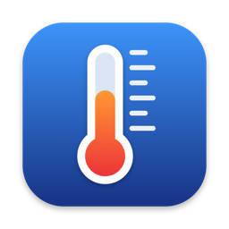
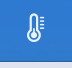

<p align="center"></p>

# HeatCheck

A tiny macOS menu bar app that shows your Mac's thermal state.

[Українською](README.uk.md)



- **Small enough to read.** The whole app is one Swift file of about 130 lines.
- **Public API only.** It uses Apple's documented `ProcessInfo.thermalState`. No private APIs, no sensor hacks.
- **Sandboxed.** It runs in the macOS App Sandbox with no extra permissions: no network, no file access.
- **Nothing privileged.** No `sudo`, no kernel extensions, no background helpers.
- **Light.** There are no timers: the app wakes up only when macOS reports a change. At idle it uses ~0% CPU and about 19 MB of memory.

## What it shows

| Menu bar | State | What it means |
|---|---|---|
| Gray thermometer | Normal | Within normal limits |
| Yellow, "Elevated" | Fair | Slightly above normal |
| Orange, "Hot" | Serious | macOS may already be slowing the Mac down to cool it |
| Red, "Critical" | Critical | The Mac is heavily throttled until it cools down |

Click the icon to see the current state, a short explanation and when it last changed.

The interface is in English, or in Ukrainian if Ukrainian is your Mac's first preferred language.

## Why not degrees?

Apple has no public API for CPU temperature on Apple silicon. Apps that show degrees read undocumented sensors. Those readings can stop working after a macOS update, and such apps generally can't run in the sandbox.

`thermalState` is the signal macOS itself uses to decide when to throttle, so it answers the practical question: is my Mac too hot right now? Apple doesn't map the levels to degrees. The thresholds differ between models, and macOS takes more than the CPU into account.

## Build and run

You need macOS with the Xcode Command Line Tools (Swift 6 or newer). Full Xcode isn't required. If you don't have the tools yet, install them once:

```bash
xcode-select --install
```

Then clone or download this repository and run:

```bash
cd HeatCheck
./build.sh
open build/HeatCheck.app
```

`build.sh` compiles the app with `swiftc`, assembles the `.app` bundle and signs it locally with the sandbox entitlement. It downloads nothing.

To keep the app around, drag `build/HeatCheck.app` into your Applications folder.

- **Start at login:** System Settings → General → Login Items → **+** → choose `HeatCheck.app`.
- **Quit:** click the menu bar icon → **Quit** (⌘Q).

## Check the sandbox yourself

```bash
codesign -d --entitlements - HeatCheck/build/HeatCheck.app
```

The only entitlement listed should be `com.apple.security.app-sandbox`.

## Why no prebuilt download?

The app is signed locally and isn't notarized by Apple, so macOS would block a copy downloaded from the internet. Building it yourself takes a few seconds, and you can read every line before you run it.

## Files

| File | Purpose |
|---|---|
| `HeatCheck/HeatCheck.swift` | The whole app |
| `HeatCheck/Info.plist` | Bundle settings (no Dock icon) |
| `HeatCheck/HeatCheck.entitlements` | App Sandbox, nothing else |
| `HeatCheck/build.sh` | Builds and signs the app |
| `HeatCheck/AppIcon.icns` | The app icon |
| `HeatCheck/make-icon.swift`, `make-icon.sh` | Draw the icon in code |

## Changing the icon

The icon is drawn in code with custom shapes, without SF Symbols or image files. Edit `make-icon.swift`, then run:

```bash
cd HeatCheck
./make-icon.sh
./build.sh
```

## License

MIT. See [LICENSE](LICENSE).
