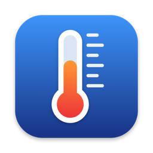
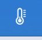

<p align="center"></p>

# HeatCheck

Маленька програма для рядка меню macOS, яка показує тепловий стан Mac.

[English](README.md)



- **Можна прочитати повністю.** Уся програма — один файл Swift приблизно на 130 рядків.
- **Лише публічний API.** Використовує задокументований Apple `ProcessInfo.thermalState`. Жодних приватних API і хитрощів із сенсорами.
- **У пісочниці.** Працює в пісочниці macOS (App Sandbox) без додаткових дозволів: ні мережі, ні доступу до файлів.
- **Без особливих прав.** Не потрібні ні `sudo`, ні розширення ядра, ні фонові помічники.
- **Легка.** Таймерів немає: програма прокидається лише тоді, коли macOS повідомляє про зміну стану. У простої — близько 0% процесора і приблизно 19 МБ пам'яті.

## Що вона показує

| Рядок меню | Стан | Що це означає |
|---|---|---|
| Сірий термометр | Норма | У межах норми |
| Жовтий, «Помірно» | Fair | Трохи вище норми |
| Оранжевий, «Гаряче» | Serious | macOS уже може пригальмовувати Mac, щоб охолодити |
| Червоний, «Критично» | Critical | Mac сильно пригальмовує, доки не охолоне |

Клацніть на значок, щоб побачити поточний стан, коротке пояснення і час останньої зміни.

Інтерфейс англійською, або українською, якщо українська стоїть першою серед мов вашого Mac.

## Чому не градуси?

Apple не має публічного API для температури процесора на Apple silicon. Програми, які показують градуси, читають недокументовані сенсори. Після оновлення macOS такі показники можуть перестати працювати, і такі програми зазвичай не можуть працювати в пісочниці.

`thermalState` — це той самий сигнал, за яким macOS вирішує, коли пригальмовувати Mac. Тому він відповідає на практичне питання: чи Mac зараз не перегрівся? Apple не прив'язує рівні до градусів: пороги в різних моделей різні, і macOS враховує не лише процесор.

## Збірка і запуск

Потрібна macOS з Xcode Command Line Tools (Swift 6 або новіший). Повний Xcode не потрібен. Якщо інструментів ще немає, встановіть їх один раз:

```bash
xcode-select --install
```

Потім клонуйте або завантажте цей репозиторій і запустіть:

```bash
cd HeatCheck
./build.sh
open build/HeatCheck.app
```

`build.sh` компілює програму через `swiftc`, збирає пакет `.app` і локально підписує його з дозволом на пісочницю. Нічого не завантажує.

Щоб програма лишалася під рукою, перетягніть `build/HeatCheck.app` у папку «Програми».

- **Автозапуск:** Системні параметри → Загальні → Об'єкти входу → **+** → виберіть `HeatCheck.app`.
- **Вийти:** клацніть на значок у рядку меню → **Вийти** (⌘Q).

## Перевірте пісочницю самі

```bash
codesign -d --entitlements - HeatCheck/build/HeatCheck.app
```

Єдиним дозволом у списку має бути `com.apple.security.app-sandbox`.

## Чому немає готової програми для завантаження?

Програма підписана локально і не нотаризована Apple, тож macOS заблокує копію, завантажену з інтернету. Зібрати її самому — справа кількох секунд, і так ви можете прочитати кожен рядок перед запуском.

## Файли

| Файл | Для чого |
|---|---|
| `HeatCheck/HeatCheck.swift` | Уся програма |
| `HeatCheck/Info.plist` | Налаштування пакета (без значка в Dock) |
| `HeatCheck/HeatCheck.entitlements` | Лише пісочниця, нічого більше |
| `HeatCheck/build.sh` | Збирає й підписує програму |
| `HeatCheck/AppIcon.icns` | Іконка програми |
| `HeatCheck/make-icon.swift`, `make-icon.sh` | Малюють іконку з коду |

## Як змінити іконку

Іконку намальовано кодом із власних фігур, без SF Symbols і файлів зображень. Змініть `make-icon.swift`, потім запустіть:

```bash
cd HeatCheck
./make-icon.sh
./build.sh
```

## Ліцензія

MIT. Див. [LICENSE](LICENSE).
